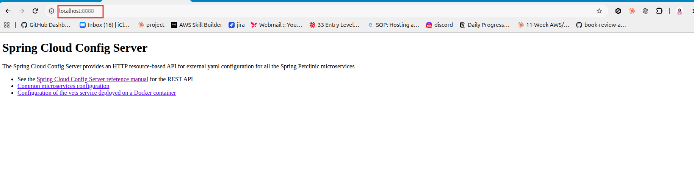
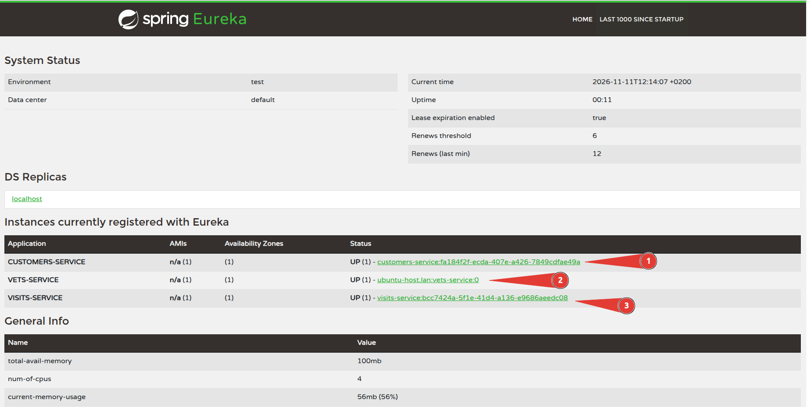
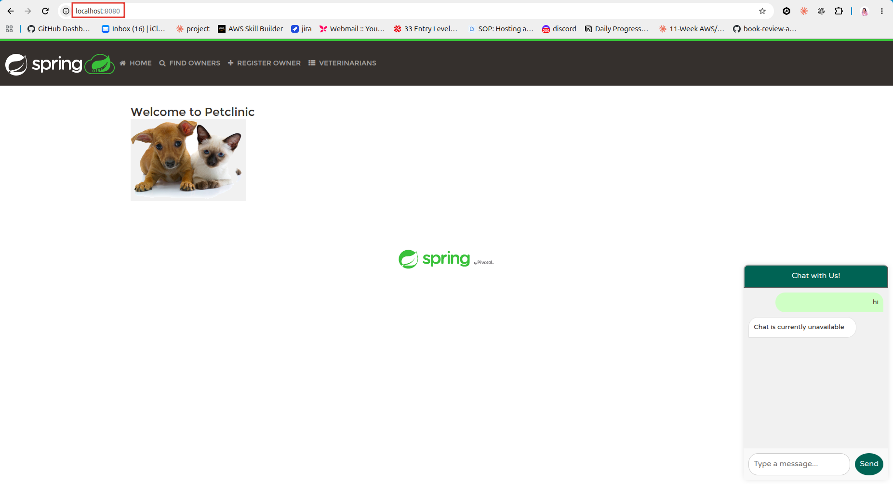

# Spring PetClinic Microservices: Local Deployment SOP

## 1. Purpose and Deployment Scope

This Standard Operating Procedure (SOP) describes how to deploy and run the Spring PetClinic Microservices application directly on a local development machine.

The procedure covers preparing the project, starting the required microservices in the correct order, verifying service registration and application accessibility, and shutting down the application.

**Deployment approach:** Native local deployment using Java and the Maven Wrapper.

**Services covered:**
- Spring Cloud Config Server
- Discovery Server (Eureka)
- Customers Service
- Vets Service
- Visits Service
- API Gateway

This procedure does not cover Docker, Docker Compose, Kubernetes or AWS deployment.

## 2. Prerequisites

Before starting, ensure the following tools are installed:

| Requirement | Purpose |
|---|---|
| Git | Clone the project repository |
| Java JDK 21 | Run the Spring Boot microservices |
| Maven Wrapper | Build and run the application |
| Web browser | Access application interfaces and verification endpoints |

The project includes a Maven Wrapper, so a separate Maven installation is not required.

Verify Java installation:

```bash
java --version
```

Verify Git installation:

```bash
git --version
```

## 3. Getting the Project Ready

Clone the Spring PetClinic Microservices repository:

```bash
git clone https://github.com/spring-petclinic/spring-petclinic-microservices.git
```

Navigate to the project root directory.

All subsequent Maven commands in this procedure must be executed from the project root.

The Maven Wrapper is provided in the repository and is used to execute the application's Maven goals.

**Maven Wrapper commands by operating system:**

| Operating system | Command |
|---|---|
| Linux | `./mvnw` |
| macOS | `./mvnw` |
| Windows Command Prompt | `mvnw.cmd` |
| Windows PowerShell | `.\mvnw.cmd` |

On Linux or macOS, ensure the Maven Wrapper is executable:

```bash
chmod +x mvnw
```

## 4. Application Architecture and Startup Order

Spring PetClinic is composed of several independent microservices that communicate with one another.

Some services depend on infrastructure services being available before they can start and register successfully.

The following startup order is used:

1. Config Server
2. Discovery Server
3. Customers Service
4. Vets Service
5. Visits Service
6. API Gateway

**Why this order matters:**

- Config Server provides externalised configuration to the microservices.
- Discovery Server provides service registration and discovery through Eureka.
- Customers, Vets and Visits retrieve their configuration and register with Eureka.
- API Gateway provides the entry point through which requests reach the backend services.

Keep each service running in its own terminal while proceeding to the next service.

## 5. Starting the Services

Run each command from the project root directory.

Open a separate terminal for every service and wait for it to finish starting before proceeding.

### 5.1 Start Config Server

```bash
./mvnw -pl spring-petclinic-config-server spring-boot:run
```

Config Server provides centralised configuration to the application services.

### 5.2 Start Discovery Server

```bash
./mvnw -pl spring-petclinic-discovery-server spring-boot:run
```

Discovery Server provides the Eureka service registry.

### 5.3 Start Customers Service

```bash
./mvnw -pl spring-petclinic-customers-service spring-boot:run
```

### 5.4 Start Vets Service

```bash
./mvnw -pl spring-petclinic-vets-service spring-boot:run
```

### 5.5 Start Visits Service

```bash
./mvnw -pl spring-petclinic-visits-service spring-boot:run
```

### 5.6 Start API Gateway

```bash
./mvnw -pl spring-petclinic-api-gateway spring-boot:run
```

The API Gateway provides the application's main access point.

**Note:** The commands above use Linux and macOS Maven Wrapper syntax. On Windows, replace `./mvnw` with the appropriate Windows wrapper command described in Section 3.

## 6. Verifying the Deployment

After all services have started, verify that the application components are running and communicating as expected.

### 6.1 Verify Config Server

Open the following URL in a browser:

http://localhost:8888



The endpoint should return the shared application configuration.

### 6.2 Verify Discovery Server

Open:

http://localhost:8761

The Eureka dashboard should be accessible.

Confirm that the following services appear as registered instances with an `UP` status:

- Customers Service
- Vets Service
- Visits Service



### 6.3 Verify API Gateway

Confirm that the API Gateway has started successfully and is listening on port `8080`.

### 6.4 Verify the PetClinic Application

Open:

http://localhost:8080

The PetClinic application should load successfully.

Navigate through the application and confirm that its main functionality is accessible.

A successful deployment requires the infrastructure services to be available, the backend services to register successfully, and the application to be accessible through the API Gateway.



## 7. Stopping the Services

To stop the application, return to each terminal where a service is running.

Press:

```text
Ctrl + C
```

Stop the services in reverse order of startup:

1. API Gateway
2. Visits Service
3. Vets Service
4. Customers Service
5. Discovery Server
6. Config Server

This ensures that the application services are stopped before their supporting infrastructure services.

## 8. Troubleshooting

The following table describes common issues that may occur during local deployment.

| Problem | Possible cause | Recommended action |
|---|---|---|
| Config Server unavailable | Config Server has not started or cannot access its Git configuration repository | Check Config Server logs and confirm repository connectivity |
| Service fails to register with Eureka | Discovery Server is unavailable or service configuration is incorrect | Confirm Eureka is running and inspect the service logs |
| Service fails to start | Missing dependencies, configuration errors or port conflicts | Review the startup logs and resolve the reported issue |
| Application inaccessible through port 8080 | API Gateway has not started successfully | Check API Gateway logs and confirm it is running |
| Service shows unavailable in Eureka | Service has stopped, failed registration or has not completed its heartbeat cycle | Check the service process and allow time for registration status to update |

Always investigate the relevant service logs before making configuration changes.
