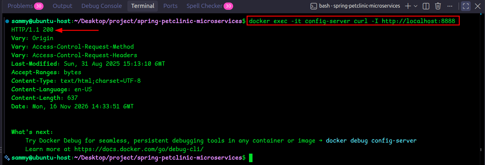
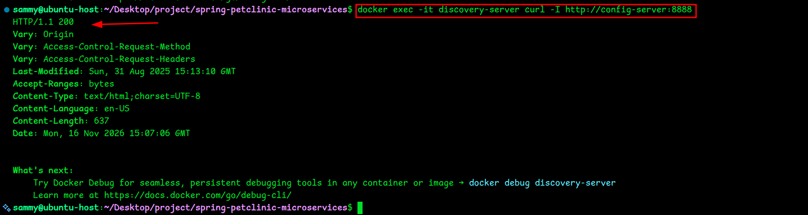

# SPC-31: Docker Compose Services and Build Configuration Analysis

## 1. Objective

The purpose of this task is to inspect and understand the existing Docker Compose configuration used to deploy the Spring PetClinic Microservices application.

The inspection covers:

- Docker Compose services and their image sources.
- Build versus pull behaviour.
- Port mappings.
- Environment variables.
- Service dependencies and startup order.
- Docker networks and volumes.
- Runtime container status.

## 2. Docker Compose Configuration

The project uses the root `docker-compose.yml` file to define and manage its services.

The configuration contains 11 services:

1. Config Server
2. Discovery Server
3. Customers Service
4. Visits Service
5. Vets Service
6. GenAI Service
7. API Gateway
8. Tracing Server (Zipkin)
9. Admin Server
10. Grafana
11. Prometheus

Each service has a container name and configuration defining how it runs.

## 3. Image Sources and Build Configuration

Inspection of `docker-compose.yml` identified:

- 9 services using the `image:` directive.
- 2 services using the `build:` directive.

### 3.1 Services using existing images

The following services reference existing Docker images:

| Service | Image |
|---|---|
| Config Server | `springcommunity/spring-petclinic-config-server` |
| Discovery Server | `springcommunity/spring-petclinic-discovery-server` |
| Customers Service | `springcommunity/spring-petclinic-customers-service` |
| Visits Service | `springcommunity/spring-petclinic-visits-service` |
| Vets Service | `springcommunity/spring-petclinic-vets-service` |
| GenAI Service | `springcommunity/spring-petclinic-genai-service` |
| API Gateway | `springcommunity/spring-petclinic-api-gateway` |
| Tracing Server | `openzipkin/zipkin` |
| Admin Server | `springcommunity/spring-petclinic-admin-server` |

The `image:` directive tells Docker Compose which image to use.

If the image is not available locally, Compose can pull it from its configured registry, subject to its pull policy.

The Spring PetClinic application images are built through the Maven Docker build configuration inspected under SPC-30.

### 3.2 Services using local builds

Grafana and Prometheus use local Docker build contexts.

| Service | Build context |
|---|---|
| Grafana | `./docker/grafana` |
| Prometheus | `./docker/prometheus` |

The Grafana Dockerfile uses `grafana/grafana:11.4.0` as its base image and adds Grafana configuration, dashboards and provisioning files.

The Prometheus Dockerfile uses `prom/prometheus:v3.1.0` as its base image and adds the Prometheus configuration file.

These Dockerfiles customise existing upstream images rather than building the monitoring applications from source code.

### 3.3 Build versus pull

The distinction is important:

- `image:` references an image that Compose should use, pulling it if necessary.
- `build:` instructs Compose to build an image using a local build context.
- Building a Docker image does not necessarily mean compiling application source code.
- The Spring PetClinic application images are handled by the Maven-driven Docker build process documented in SPC-30.

## 4. Port Mappings

The following port mappings were identified in `docker-compose.yml`.

| Service | Host port | Container port |
|---|---:|---:|
| Config Server | 8888 | 8888 |
| Discovery Server | 8761 | 8761 |
| Customers Service | 8081 | 8081 |
| Visits Service | 8082 | 8082 |
| Vets Service | 8083 | 8083 |
| GenAI Service | 8084 | 8084 |
| API Gateway | 8080 | 8080 |
| Tracing Server | 9411 | 9411 |
| Admin Server | 9090 | 9090 |
| Grafana | 3030 | 3000 |
| Prometheus | 9091 | 9090 |

The port mapping format is:

`HOST_PORT:CONTAINER_PORT`

This publishes a container port on the Docker host so that services can be accessed externally.

For example:

- PetClinic API Gateway: `http://localhost:8080`
- Config Server: `http://localhost:8888`
- Discovery Server: `http://localhost:8761`
- Grafana: `http://localhost:3030`
- Prometheus: `http://localhost:9091`
- Zipkin: `http://localhost:9411`

## 5. Environment Variables

The Compose configuration defines environment variables for the GenAI Service.

The inspected variables are:

| Variable | Purpose |
|---|---|
| `OPENAI_API_KEY` | Authentication for OpenAI API requests |
| `AZURE_OPENAI_KEY` | Authentication for Azure OpenAI |
| `AZURE_OPENAI_ENDPOINT` | Azure OpenAI service endpoint |

The values are passed into the container using variable substitution:

`OPENAI_API_KEY=${OPENAI_API_KEY}`

The other two variables follow the same pattern.

During inspection, the three variables were checked in the current shell and were not set.

No root-level `.env` file was found during the repository inspection.

This does not establish whether alternative environment injection mechanisms are configured elsewhere.

No API keys or secret values were added to the documentation.

## 6. Service Dependencies and Startup Order

The Compose configuration contains seven `depends_on:` declarations.

The service relationships are:

| Service | Depends on |
|---|---|
| Discovery Server | Config Server |
| Customers Service | Config Server, Discovery Server |
| Visits Service | Config Server, Discovery Server |
| Vets Service | Config Server, Discovery Server |
| GenAI Service | Config Server, Discovery Server |
| API Gateway | Config Server, Discovery Server |
| Admin Server | Config Server, Discovery Server |

The dependencies use:

`condition: service_healthy`

This means Compose waits for the specified dependency's healthcheck to pass before starting the dependent service.

### 6.1 Config Server

The Config Server exposes port 8888.

Its healthcheck uses:

`curl -I http://config-server:8888`

The healthcheck is configured with an interval of 5 seconds, timeout of 5 seconds and 10 retries.

### 6.2 Discovery Server

Discovery Server exposes port 8761.

Its healthcheck uses:

`curl -f http://discovery-server:8761`

The healthcheck is configured with an interval of 5 seconds, timeout of 3 seconds and 10 retries.

### 6.3 Application services

The application services depend on both Config Server and Discovery Server.

Config Server provides externalised application configuration, while Eureka Discovery Server provides service registration and discovery.

This dependency structure supports the startup requirements of the microservices architecture.

### 6.4 Independent services

Tracing Server, Grafana and Prometheus do not have explicit `depends_on:` declarations in the inspected Compose file.

## 7. Volumes

Inspection of `docker-compose.yml` found no explicit `volumes:` declarations.

This means the Compose configuration does not explicitly define named volumes or bind mounts for persistent storage.

Docker containers have a writable layer, but data stored only in that layer is tied to the container lifecycle.

Persistent storage requirements should therefore be considered separately, particularly for services that maintain application data.

No claim is made that all application data is stored persistently or that the underlying images have no other storage configuration.

## 8. Networks

No custom `networks:` section is explicitly defined in `docker-compose.yml`.

Docker Compose automatically creates the network:

`spring-petclinic-microservices_default`

The network inspection confirmed the following configuration:

| Property | Value |
|---|---|
| Network name | `spring-petclinic-microservices_default` |
| Driver | `bridge` |
| Scope | `local` |
| Subnet | `172.19.0.0/16` |
| Gateway | `172.19.0.1` |
| IPv6 | Disabled |

The initial network inspection, while most Compose containers were stopped, showed four attached containers:

| Container | IP address |
|---|---|
| tracing-server | `172.19.0.2` |
| prometheus-server | `172.19.0.3` |
| config-server | `172.19.0.4` |
| grafana-server | `172.19.0.5` |

A subsequent `docker ps` confirmed that 10 of the 11 Compose services were running.

The network was not inspected again after those additional services started, so their network attachment and IP addresses have not been independently recorded.

Docker Compose provides service-name-based DNS resolution for containers attached to the same Compose network.

Services should therefore communicate using their service names rather than relying on fixed container IP addresses.

The Kind Kubernetes nodes use a separate Docker network and are not part of this Compose network.

## 9. Runtime Container Status

The Compose containers were inspected using:

`docker ps -a`

After restarting the previously stopped containers, a subsequent `docker ps` showed the following runtime state:

| Service | Runtime status |
|---|---|
| Config Server | Up, healthy |
| Discovery Server | Not present in running container list |
| Customers Service | Up |
| Visits Service | Up |
| Vets Service | Up |
| GenAI Service | Up |
| API Gateway | Up |
| Admin Server | Up |
| Tracing Server | Up, healthy |
| Grafana | Up |
| Prometheus | Up |

At the time of the latest runtime inspection:

- 10 of the 11 Compose services were running.
- Config Server and Tracing Server reported healthy status.
- Discovery Server was not present in the running container list.
- The other running services did not display Docker health status in the supplied output.

The previous `docker ps -a` output showed the stopped application containers with exit code 143. This indicates termination by SIGTERM and does not, on its own, establish the cause of the earlier shutdown.

The three Kind Kubernetes nodes were also running, but they are separate from this Compose deployment.

## 10. Engineering Observations

The inspection established several important characteristics of the deployment:

1. The application images are referenced through prebuilt image names, while Grafana and Prometheus are built locally.
2. Maven is responsible for the Spring PetClinic application image build process.
3. Config Server and Discovery Server are important dependencies for the application services.
4. The Compose configuration uses healthcheck-based dependency conditions.
5. Docker Compose automatically creates a default bridge network when no custom network is defined.
6. Service-name-based communication is preferable to relying on container IP addresses.
7. No explicit Compose volumes are configured.
8. The GenAI Service has environment variable references for OpenAI and Azure OpenAI credentials and configuration.
9. Runtime inspection confirmed that most services were running, but Discovery Server was absent from the latest running container list.

## 11. Verification Evidence

The following commands were used during the inspection:

| Command | Purpose |
|---|---|
| `grep -nE "image:|build:" docker-compose.yml` | Identify image and build declarations |
| `grep -c 'image:' docker-compose.yml` | Count image declarations |
| `grep -c 'depends_on:' docker-compose.yml` | Count dependency declarations |
| `grep -n "depends_on:" docker-compose.yml` | Locate dependency definitions |
| `sed -n '1,160p' docker-compose.yml` | Inspect Compose configuration |
| `grep -nE "environment:|volumes:|networks:" docker-compose.yml` | Inspect environment, volume and network declarations |
| `docker network ls` | List Docker networks |
| `docker network inspect spring-petclinic-microservices_default` | Inspect Compose network configuration and attached containers |
| `docker ps -a` | Inspect running and stopped containers |
| `docker ps` | Inspect currently running containers |
| `docker logs config-server` | Inspect Config Server startup and configuration activity |

Supporting screenshots are stored in:

`docs/project-documentation/images/docker/`

## 12. Conclusion

The inspection of the existing Docker Compose configuration established how the Spring PetClinic microservices and supporting infrastructure are configured and managed together.

The work identified the image sources, local build contexts, port mappings, environment variables, service dependencies, default network configuration and absence of explicit Compose volume declarations.

Runtime inspection confirmed that 10 of the 11 Compose services were running at the latest check, with Discovery Server absent from the running container list.

The findings provide a clearer understanding of how Docker Compose coordinates the local microservices deployment and provide a foundation for subsequent deployment and operational verification tasks.

